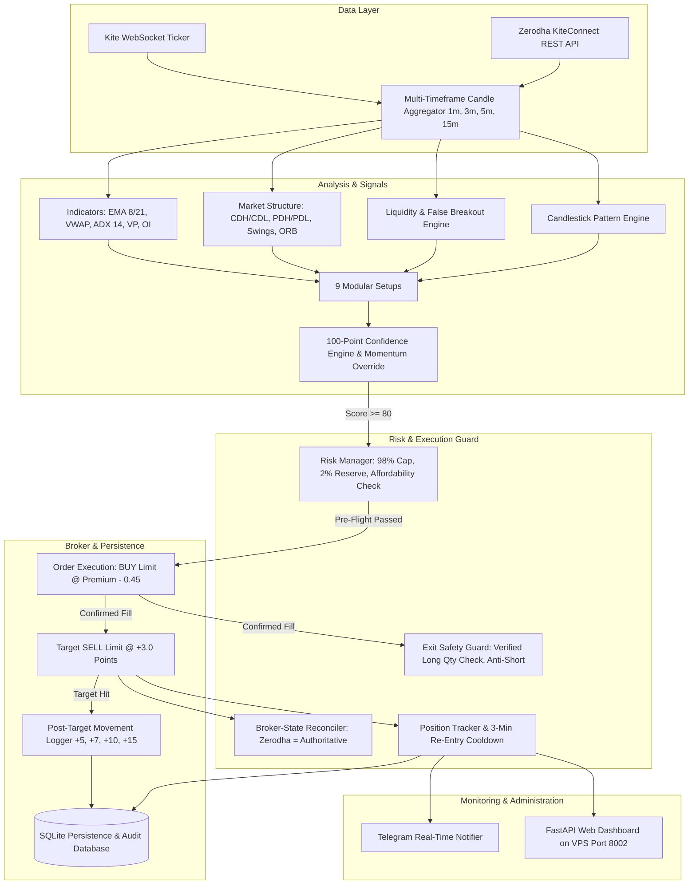

# NIFTY 50 Options-Buying Production Algorithm (+3 Point Fixed Target Engine)

**Production-grade, modular automated trading system** built with Python and Zerodha Kite Connect, running under `systemd` on an Ubuntu VPS (Heaven Cloud).

---

## 1. System Architecture Overview



---

## 2. Unresolved Strategy Parameters (Confirmation Required Before Live Trading)

Per instructions, the algorithm **does not invent missing parameters**. The following parameters are currently configurable in `config.json` and must be confirmed prior to LIVE execution:

1. **Maximum Monetary Loss Per Trade (`max_loss_per_trade_inr`)**:
   - The monetary stop loss cap per trade is currently set to `null` (REQUIRED before LIVE). The algorithm will refuse to run in LIVE mode until an approved number (e.g. ₹600 or ₹1,000) is confirmed.
2. **Exact BUY Order Timeout (`buy_order_timeout_seconds`)**:
   - Default configured to **30 seconds**. If unfilled, the remaining balance is cancelled, and only confirmed fills are managed.
3. **Reference Quote for `current_premium - ₹0.45`**:
   - Uses the latest LTP or Best Ask from Kite market depth snapshot at signal detection.
4. **Market-Structure Invalidation Buffer (`stop_structure_buffer_points`)**:
   - Default configured to **2.0 points** beyond the 3-minute swing low (for CE) or swing high (for PE).
5. **Adverse Overnight Gap Threshold (`adverse_overnight_gap_threshold_pts`)**:
   - Default configured to **40.0 NIFTY spot points**.
6. **Overnight Protective Reference**:
   - Favourable gap protective level set at current option premium minus ₹2.0. Must be reconciled without creating conflicting SELL orders.
7. **Approved Live Trading Capital**:
   - Configured example is ₹5,000. If 1 lot cannot be afforded under 98% deployable capital (2% reserve), the trade is skipped.
8. **External News & Market Breadth Data Sources**:
   - Option chain PCR and intraday volume profiles are computed locally from Kite data.

---

## 3. Strict Non-Negotiable Safety Rules Implemented

- **STRICT BUY-ONLY**: Never opens short CE or PE positions under any circumstances.
- **VERIFIED REMAINING LONG QUANTITY**: Before placing any exit SELL order, queries Zerodha live positions and orders directly. SELL quantity can never exceed verified remaining long quantity.
- **NO DUPLICATE ORDERS**: Enforces idempotency via unique trade IDs and client order tags.
- **PARTIAL FILL CANCELLATION**: If less than one full lot executes on BUY, cancels the remaining balance, confirms cancellation, and manages only the confirmed filled units.
- **AUTHORITATIVE RECONCILIATION**: Zerodha is the single source of truth. SQLite is an audit and recovery aid.
- **CIRCUIT BREAKER**: Ceases new entries after 3 consecutive losing trades in a day. A winning trade resets the counter.
- **MANDATORY COOLDOWN**: 3-minute pause following every trade completion.

---

## 4. 9 Modular Entry Setups

1. **Breakout and Retest** (`SETUP_1_BREAKOUT_RETEST`): Confirmed close beyond S/R on 3m, holds on retest.
2. **Liquidity Sweep and Reversal** (`SETUP_2_LIQUIDITY_SWEEP_REVERSAL`): BSL/SSL sweep with >= 35% rejection wick.
3. **VWAP Reclaim** (`SETUP_3_VWAP_RECLAIM`): Price crosses back across VWAP with EMA alignment.
4. **VWAP Rejection** (`SETUP_4_VWAP_REJECTION`): Upper or lower rejection wick at VWAP.
5. **Trend Continuation** (`SETUP_5_TREND_CONTINUATION`): EMA 8/21 aligned pullback with ADX >= 18.
6. **Opening-Range Breakout** (`SETUP_6_ORB_BREAKOUT`): Confirmed 3m close outside 9:15-9:30 range.
7. **Support Reversal** (`SETUP_7_SUPPORT_REVERSAL`): Hammer / Bullish Engulfing at support.
8. **Resistance Rejection** (`SETUP_8_RESISTANCE_REJECTION`): Shooting Star / Bearish Engulfing at resistance.
9. **FVG Imbalance Confirmation** (`SETUP_9_FVG_CONFIRMATION`): **STRICTLY CONFIRMATION ONLY**, never triggers independently.

---

## 5. Post-Target Market Movement Logger & Analytics (+3 Points Thru 31 Jan 2027)

After the fixed +3-point target executes:
- Continues tracking the option contract for 30 minutes without placing new orders.
- Records post-exit high, additional premium points, time-to-high, and milestones (+5, +7, +10, +15).
- Compares real performance with hypothetical models (Fixed +3 vs +5 vs +7 vs +10 vs Trailing).
- Accessible via Admin API: `GET /api/analytics`.

---

## 6. Heaven Cloud VPS Deployment & Supervision

The VPS is hosted on Heaven Cloud at `<YOUR_VPS_IP>`.

### Deployment Command
```bash
python deploy_to_heavencloud.py
```
This automatically:
1. Connects to `<YOUR_VPS_IP>` via SSH.
2. Uploads the code to `/root/nifty_3point_algo`.
3. Installs dependencies on Ubuntu.
4. Installs and starts `nifty_algo.service` on port `8002`.

### VPS Dashboard URL
- Visual Status Dashboard: `http://<YOUR_VPS_IP>:8002/`
- API Status: `http://<YOUR_VPS_IP>:8002/api/status`
- Analytics Report: `http://<YOUR_VPS_IP>:8002/api/analytics`

---

## 7. Running Locally

### Run Unit and Safety Tests
```bash
python -m pytest tests -v
```

### Run in PAPER Mode (Default Safe)
```bash
python main.py
```

### Run in LIVE Mode (Explicit Switch Required)
```bash
python main.py --live
```

### Run Multi-Timeframe Historical Backtest
```bash
python main.py --backtest historical_data/nifty_1min.csv
```
